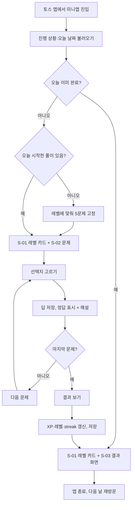

# 05. User Story / User Flow

## 1. User Story

| ID | 스토리 | 수용 기준 | 상태 |
|----|--------|-----------|------|
| US-01 | 사용자로서, 앱을 열자마자 오늘의 문제를 풀고 싶다. 바로 학습을 시작하기 위해서다. | 첫 화면에 레벨 카드와 1번 문제가 함께 보인다. | [구현] |
| US-02 | 사용자로서, 답을 고르면 바로 맞았는지 알고 싶다. 틀린 이유를 바로 이해하기 위해서다. | 선택 즉시 정답·오답 색과 해설이 나온다. | [구현] |
| US-03 | 사용자로서, 내 레벨이 오르는 걸 보고 싶다. 꾸준히 할 동기를 얻기 위해서다. | 레벨과 XP 바가 완료 직후 갱신된다. | [구현] |
| US-04 | 사용자로서, 며칠 연속으로 했는지 알고 싶다. 습관을 끊지 않기 위해서다. | "N일 연속으로 풀었어요"가 보인다. | [구현] |
| US-05 | 사용자로서, 오늘 분량을 끝냈다는 걸 확실히 알고 싶다. 더 할 게 없다는 걸 알기 위해서다. | 완료 후 결과 화면과 "새 문제는 내일 열려요"가 보인다. | [구현] |
| US-06 | 개발자 사용자로서, 실무에서 쓰는 영어 표현을 배우고 싶다. | 문제에 "개발자 영어" 태그가 붙은 문제가 섞여 있다. | [구현] |
| US-07 | 사용자로서, 틀린 문제를 다시 보고 싶다. | 결과 화면에서 오답 목록을 볼 수 있다. | [계획] |
| US-09 | 사용자로서, 풀다가 앱을 닫아도 이어서 풀고 싶다. | 다시 열면 답하지 않은 첫 문제부터 나온다. | [구현] |
| US-10 | 사용자로서, 레벨이 오르면 조금 더 어려운 문제를 풀고 싶다. | 레벨이 오를수록 중급·심화 문제 비중이 늘어난다. | [구현] |
| US-08 | 사용자로서, 휴대폰을 바꿔도 레벨을 유지하고 싶다. | 토스 로그인 후 레벨이 복원된다. | [계획] |

## 2. User Flow

### 2.1 첫 방문과 학습

### 2.2 재방문

| 상황 | 화면 |
|------|------|
| 오늘 이미 완료 | 결과 화면, 새 문제는 내일 |
| 어제 완료, 오늘 미완료 | streak 유지된 상태로 문제 시작 |
| 2일 이상 쉼 | streak 0으로 표시, 완료하면 1부터 다시 |
| 풀이 중 앱 종료 | 다시 열면 답하지 않은 첫 문제부터. 이미 고른 답은 그대로 |
| 앱을 켜 둔 채 자정이 지남 | 앱이 다시 화면에 보일 때 새 날의 문제로 바뀜 |
