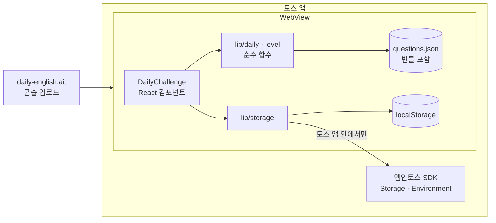
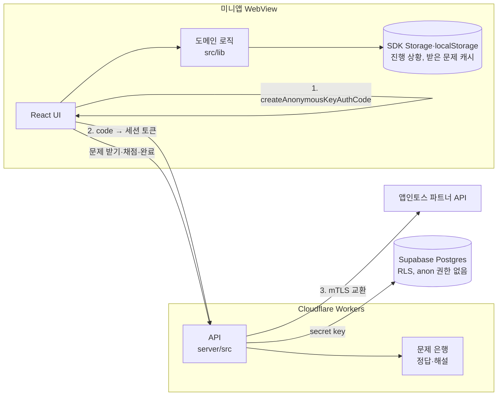

# 09. Architecture

## 1. 현재 구조 (MVP) [구현]

서버가 없는 정적 웹앱이다(기기 모드). 문제는 번들에 포함되고 진행 상황은 기기에 저장된다. 서버 주소를 넣고 빌드하면 4장의 서버 모드가 된다.



빌드: `next build` → `out/` → `ait build` → `daily-english.ait`

## 2. 레이어

| 레이어 | 위치 | 책임 | React 의존 |
|--------|------|------|------------|
| 화면 | `src/app/` | 레이아웃, 전역 스타일, 페이지 진입점 | O |
| 컴포넌트 | `src/components/` | 상태 관리, 사용자 입력, 렌더링 | O |
| 도메인 로직 | `src/lib/daily.ts`, `level.ts` | 문제 선택, XP, 레벨, streak 계산 (순수 함수) | X |
| 저장·환경 | `src/lib/storage.ts` | SDK Storage·localStorage 읽기·쓰기, 데이터 검증, 오늘 날짜(서버 시간) | X |
| 타입 | `src/lib/types.ts` | 공용 타입 | X |
| 데이터 | `src/data/questions.json` | 문제 은행 | X |

의존 방향: 화면 → 컴포넌트 → 도메인 로직·저장 → 타입·데이터. 역방향 의존은 없다.

## 3. 디렉터리

```
daily-english/
├─ docs/                  프로젝트 문서
├─ src/
│  ├─ app/
│  │  ├─ layout.tsx       html, 메타데이터, viewport, 전역 CSS
│  │  ├─ page.tsx         / 페이지
│  │  └─ globals.css      디자인 토큰, 컴포넌트 스타일
│  ├─ components/
│  │  └─ DailyChallenge.tsx  LevelCard, Quiz, 메인 컨테이너
│  ├─ lib/
│  │  ├─ types.ts
│  │  ├─ daily.ts         문제 선택, 풀이 기록, 완료, streak
│  │  ├─ level.ts
│  │  ├─ storage.ts       저장소, 토스 환경 판별, 오늘 날짜
│  │  ├─ daily.test.ts
│  │  └─ storage.test.ts
│  └─ data/
│     ├─ questions.json   문제 160개
│     └─ questions.test.ts
├─ apps-in-toss.config.ts 앱인토스 설정
├─ next.config.mjs        정적 export 설정
├─ vitest.config.ts
└─ package.json
```

## 4. 서버 모드 [구현, 운영 배포 전]

`NEXT_PUBLIC_API_BASE_URL`을 넣고 빌드하면 서버 모드다. 문제 은행(정답·해설)이 번들에서 빠지고, 서버(`server/`, Cloudflare Workers)가 문제를 내고 채점한다. 비워 두면 1장의 기기 모드 그대로다.



- 문제 고르기·XP·연속 학습일은 서버도 클라이언트와 같은 함수(`src/lib/daily.ts` 등)를 쓴다. 서버 기록을 `Progress` 모양으로 바꿔 넘긴다.
- 클라이언트는 답하기 전에는 문제와 보기만 받고, 답하면 정답·해설을 받아 기기에 보관한다(`src/lib/questionCache.ts`). 다시 볼 항목·틀린 문제·복습은 이 캐시를 쓴다.
- 닉네임·다시 볼 항목·틀린 문제·화면 모드는 지금처럼 기기에 저장한다.
- 서버 연동 전 기기 기록(XP·연속 학습일·본 문제)은 처음 한 번 서버로 옮긴다.

## 5. 설계 결정 기록

| 결정 | 이유 | 대안 |
|------|------|------|
| 서버 없이 시작 | 출시까지 가장 빠름, 비용 0 | 처음부터 Supabase |
| 순수 함수 분리 | 테스트 용이, 이후 서버 검증 로직에 재사용 | 컴포넌트 안에 로직 |
| 하루 시작 때 문제 ID 고정 저장 | 문제 은행 변경·레벨 변화와 무관하게 그날 문제 유지 | 날짜만으로 매번 계산 (처음 방식, 문제 추가 시 바뀜) |
| 토스 앱 안에서 SDK Storage | 출시 가이드의 데이터 유지 요건, WebView origin 변경 대비 | localStorage만 사용 |
| 문제 은행을 서버로 (서버 모드) | 번들에 넣으면 누구나 1,425문항과 정답을 한 번에 꺼낼 수 있다(2026-10-23 보안 점검) | 번들 유지, 인증 없는 문제 API(반복 호출로 전부 긁어 갈 수 있음) |
| 익명 식별키 교환 + Cloudflare Workers | 개인정보 없이 사용자 확인, mTLS 바인딩 지원 | 토스 로그인(약관·개인정보 동의 필요), Supabase Edge Functions(mTLS 확인 안 됨) |
| 서버 주소가 있을 때만 서버 모드 | 서버 배포 전에도 지금 빌드가 그대로 동작 | 바로 서버 필수로 전환 |
| SDK 동적 import | 브라우저 개발 환경에서 브리지 오류 방지, 번들 분리 | 정적 import |
| 컴포넌트 1파일 | 화면이 1개뿐 | 화면별 파일 분리 (화면 늘어나면 분리) |
