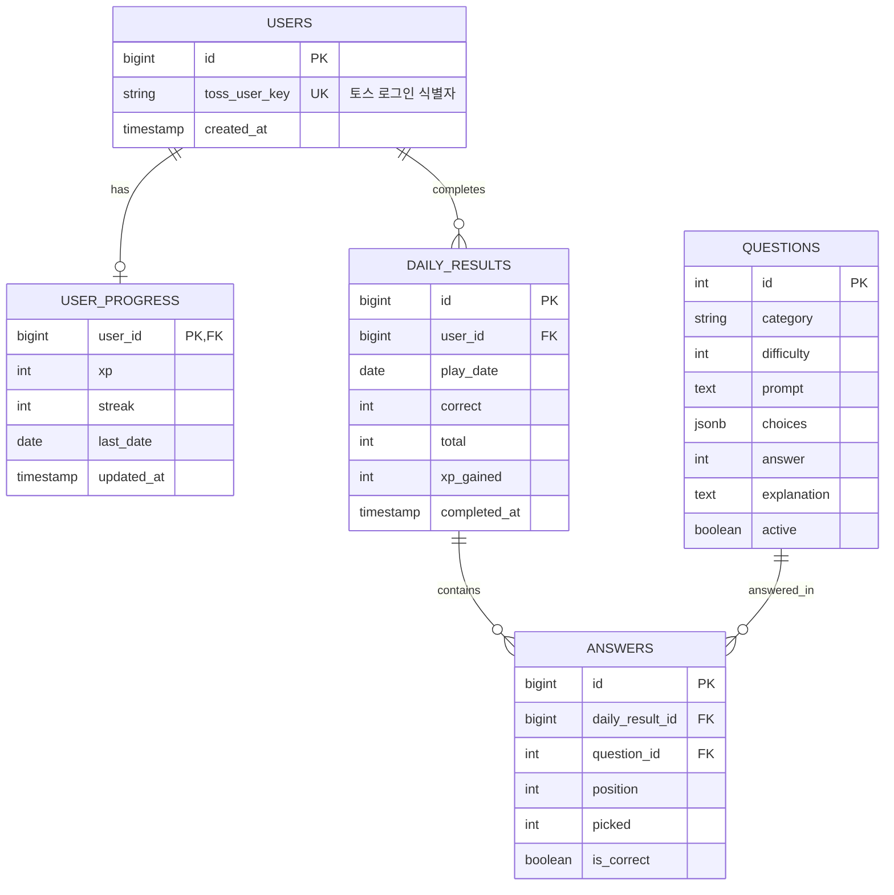

# 10. ERD / DB 설계

## 1. 현재: 로컬 저장 스키마 [구현]

MVP에는 DB가 없다. 데이터는 두 곳에 있다.

### 1.1 문제 은행 `src/data/questions.json`

| 필드 | 타입 | 설명 |
|------|------|------|
| `id` | number | 고유 번호, 1부터 |
| `category` | `"dev"` \| `"office"` \| `"study"` \| `"toeic"` \| `"daily"` | 개발자 영어 / 직장 영어 / 학교 영어 / 토익 대비 / 일상 영어 |
| `difficulty` | 1 \| 2 \| 3 | 기초 / 중급 / 심화. 레벨별 출제 비율에 쓴다. |
| `prompt` | string | 빈칸(`___`)이 정확히 하나 있는 영어 문장 |
| `choices` | string[] | 서로 다른 선택지 4개 |
| `answer` | number | 정답 선택지 인덱스 (0부터) |
| `explanation` | string | 한국어 해설 |
| `translation` | string (선택) | 정답을 채운 문장의 한국어 해석. 답한 뒤에만 보여 준다 |

현재 1,425개: 분류 5개 × 난이도 3단계마다 95개, 모두 해석이 있다. 서버 모드는 같은 형식의 `src/data/questions.extra.json`(id 1426부터, 모든 문항에 해석 필수)을 합쳐 쓴다. 2026-10-25 기준 추가 문항 500개, 목표 21,900개 ([20_문제_은행_확장](20_문제_은행_확장.md)). 두 파일 모두 저장소에 올리지 않고, 공개 저장소에는 `questions.sample.json`만 있다.

형식 규칙은 `src/data/questions.test.ts`가 두 파일을 합쳐 검사한다.

### 1.2 진행 상황

- 키: `daily-english:progress:v1`
- 저장소: 토스 앱 안에서는 SDK `Storage`와 localStorage, 브라우저에서는 localStorage

```json
{
  "xp": 145,
  "streak": 3,
  "lastDate": "2026-10-21",
  "today": { "date": "2026-10-21", "correct": 4, "total": 5, "xpGained": 45 },
  "attempt": { "date": "2026-10-21", "ids": [12, 37, 4, 58, 81], "picks": [1, 2, 0, 2, 1] },
  "seen": [1, 2, 3, 12, 37, 4, 58, 81]
}
```

| 필드 | 타입 | 설명 |
|------|------|------|
| `xp` | number | 누적 XP. 레벨은 저장하지 않고 XP로 계산 |
| `streak` | number | 마지막 완료일 기준 연속일 |
| `lastDate` | string \| null | 마지막 완료일 `yyyy-mm-dd` |
| `today` | object \| null | 마지막 완료일의 결과 |
| `attempt` | object \| null | 가장 최근 하루의 고정 문제 ID와 고른 답. 완료 후에도 남는다. |
| `seen` | number[] | 한 번이라도 출제된 문제 ID |
| `userKey` | string \| null | 앱인토스 사용자 식별키(`User.getAnonymousKey`의 hash). 다른 키로 열리면 새로 시작 |
| `nickname` | string \| null | 닉네임 |
| `saved` | object[] | 다시 볼 문장·단어 `{ questionId, kind, savedAt }` |
| `bonus` | object[] | 그날 연 보너스 문제 `{ date, source, ids, picks, result }` |
| `goal` | string \| null | 학습 목적 `dev` \| `office` \| `study` \| `toeic` \| `daily`. 고르기 전에는 null (F-15) |
| `selfLevel` | 1 \| 2 \| 3 \| null | 스스로 고른 실력. 시작 난이도에만 쓴다 |
| `wrong` | object[] | 틀린 문제 `{ questionId, pick, date }`, 최근 200개 (F-08) |

### 1.3 화면 모드

- 키: `daily-english:theme:v1`, 값: `"default"` | `"contrast"` | `"dark"` (문자열 그대로)
- 저장소는 진행 상황과 같다. 첫 화면 전에 동기로 읽어야 해서 localStorage 사본은 항상 쓴다.

`attempt`, `seen`과 그 뒤의 필드는 처음 버전에 없던 필드다. 읽을 때 없거나 형태가 틀리면 `null`, `[]`로 채우므로 키 버전은 그대로 `v1`이다.

## 2. 적용: Supabase 스키마 [구현, 서버 운영 배포 전]

2026-10-21 Supabase 프로젝트 `rbmaztwsrsyaarfysxcq`에 `supabase/migrations/20261021000000_init_user_data.sql`을 적용했다. 아래 3장의 초기 계획을 대체한다. 테이블: `users`, `daily_results`, `saved_items`. 접근 방식(서버만 secret key로 접근, anon 권한 없음)은 마이그레이션 파일 주석에 있다.

2026-10-23 마이그레이션 두 개를 더했다(로컬 Supabase에서 검증, 운영 프로젝트에는 아직 적용 전).

| 마이그레이션 | 내용 |
|--------------|------|
| `20261023000000_revoke_default_privileges.sql` | 앞으로 `public`에 만드는 테이블·시퀀스·함수도 anon·authenticated에 자동으로 열리지 않게 기본 권한을 회수한다. 함수 실행 권한(PUBLIC)은 전역으로 회수한다. 초기 마이그레이션에서 빠진 identity 시퀀스 권한도 회수한다 |
| `20261023000100_server_daily_sets.sql` | 서버가 문제를 내고 채점하도록 `daily_results`에 `kind`(daily·share·ad), `review`, `profile`, `reissues`를 더하고 유일 키를 (사용자, 날짜, 종류)로 바꾼다. `users`의 `xp`·`streak`·`last_date`는 `imported_*`로 이름을 바꾸고(서버 연동 전 기기 기록), `imported_seen`·`imported_at`을 더한다 |

- 지금 XP·연속 학습일은 `imported_*`에서 시작해 완료한 세트(`daily_results.xp_gained`)를 날짜순으로 더해 계산한다. 카운터를 따로 두지 않아 동시 요청에도 어긋나지 않는다.
- 사용자마다 날짜별로 세트가 하나씩이라(유일 키) 문제 은행을 한꺼번에 가져갈 수 없다.
- 답 저장·완료는 조건부 쓰기다(`picks`가 그대로일 때만, `completed_at`이 비었을 때만).

## 3. 초기 계획 (참고용) [대체됨]



### 제약과 인덱스

| 테이블 | 제약 | 목적 |
|--------|------|------|
| `daily_results` | UNIQUE (`user_id`, `play_date`) | 하루 1회 완료 보장 |
| `answers` | UNIQUE (`daily_result_id`, `position`) | 문제당 답 1개 |
| `users` | UNIQUE (`toss_user_key`) | 사용자 중복 방지 |
| `questions` | `active` 플래그 | 오류 문제를 지우지 않고 숨김 |

### 설계 메모

- 로컬의 `attempt`는 `daily_results` + `answers`로, `seen`은 `answers`의 `question_id` 집합으로 대신한다.
- `user_progress`는 `daily_results`로 다시 계산할 수 있는 요약 테이블이다.
- 토스 로그인에서 받는 식별자 형식과 저장 가능 범위는 [확인 필요].
