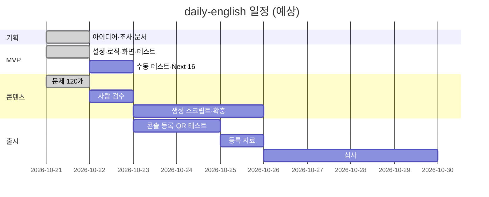

# 14. WBS (Work Breakdown Structure)

- 기준: 1인, 착수 2026-10-21
- 상태: 완료 / 진행 / 대기

## 1. 작업 분해

| WBS | 작업 | 산출물 | 예상 | 상태 |
|-----|------|--------|------|------|
| **1** | **기획** | | | |
| 1.1 | 아이디어 검토 | 결정 | 0.5일 | 완료 |
| 1.2 | 앱인토스 개발 방식 조사 | 플랫폼 결정 (WebView) | 0.5일 | 완료 |
| 1.3 | 프로젝트 문서 작성 | `docs/` | 1일 | 완료 |
| 1.4 | 앱인토스 개발자센터 문서 확인 | [16_앱인토스_연동_조사](16_앱인토스_연동_조사.md) | 1일 | 완료 |
| **2** | **MVP 개발** | | | |
| 2.1 | 프로젝트 설정 (Next.js, TS, Vitest) | 설정 파일 | 0.5일 | 완료 |
| 2.2 | 도메인 로직 (문제 선택, XP, 레벨, streak) | `src/lib/` | 0.5일 | 완료 |
| 2.3 | 화면 (레벨 카드, 퀴즈, 결과) | `DailyChallenge.tsx` | 0.5일 | 완료 |
| 2.4 | 디자인 토큰 | `globals.css` | 0.5일 | 완료 |
| 2.5 | Node.js 설치, `npm install` | 실행 환경 | 0.5일 | 완료 |
| 2.6 | 단위 테스트 실행 | 152개 통과 | 0.5일 | 완료 |
| 2.7 | 정적 빌드 확인 | `out/` | 0.5일 | 완료 |
| 2.8 | 알려진 한계 개선 (이어 풀기, 자정, 문제 고정) | 코드 | 1일 | 완료 |
| 2.9 | 레벨별 난이도 (F-09) | 코드, 테스트 | 0.5일 | 완료 |
| 2.10 | 출시 가이드 대응 (라이트 모드, 핀치 줌 차단) | 코드 | 0.5일 | 완료 |
| 2.11 | 브라우저 수동 테스트 (TC-50~56) | 결과 기록 | 0.5일 | 대기 |
| 2.12 | Next 16·Vitest 5 업그레이드 (취약점 0건) | 코드 | 0.5일 | 완료 |
| 2.13 | 접근성 점검·개선, 자동 검사 | [17_접근성](17_접근성.md) | 0.5일 | 완료 |
| 2.14 | 스크린리더 실기기 테스트 (TC-65) | 결과 기록 | 0.5일 | 대기 |
| 2.15 | 화면 모드 (기본·고대비·어둡게) | `theme.ts`, `ThemePicker.tsx` | 0.5일 | 완료 |
| 2.16 | 사용자 선택형 다크 모드 허용 여부 개발자 커뮤니티 문의 | 답변 | - | 대기 |
| 2.17 | 사용자 식별키 발급·저장 (체크리스트 공통 항목) | `loadUserKey`, `bindUser` | 0.5일 | 완료 |
| 2.18 | 앱인토스 플러그인 설치, docs·console MCP 인가 | 플러그인 0.2.6, 워크스페이스 Hei | - | 완료 |
| 2.19 | devtools 주입, 개발 서버에서 SDK 경로가 mock을 타도록 수정 | `next.config.mjs`, `canUseSdk()` | 0.5일 | 완료 |
| 2.20 | devtools 패널로 브라우저 수동 확인 (식별키 변경, 저장소, 서버 시간, 내비게이션 바) | 결과 기록 | 0.5일 | 대기 |
| **3** | **콘텐츠** | | | |
| 3.1 | 문제 120개 작성, 심화 40개 추가 (총 160개) | `questions.json` | 1일 | 완료 |
| 3.2 | 문제 데이터 검증 테스트 | `questions.test.ts` | 0.5일 | 완료 |
| 3.3 | 문제 사람 검수 (정답 유일성, 자연스러움) | 검수 기록 | 1일 | 대기 |
| 3.4 | 문제 생성 스크립트 (Claude API) | 스크립트 | 1일 | 대기 |
| 3.5 | 문제 확충: 250개 → 501개(분류마다 100개 이상) → 1,425개(분류·난이도마다 95개) | `questions.json` | 2일 | 완료 |
| 3.6 | 추가한 문제(1,265개) 사람 검수: 정답이 하나인지, 표현이 자연스러운지 | 검수 기록 | 3일 | 대기 |
| 3.7 | 문제 내용 기준: 부적절한 표현 금지 목록과 테스트(`contentPolicy.ts`), README 문제 작성 기준 | 코드, 문서 | - | 완료 |
| 3.8 | 문장 해석: 1,425문항 해석, 답한 뒤 해설 아래 표시(문제 풀이·틀린 문제·다시 볼 항목·복습), 서버는 채점 뒤에만 전달 | `translation`, `Translation.tsx` | 1일 | 완료 (2026-10-25), 미배포 |
| 3.9 | 출제 규칙 "새 문제 우선", 추가 문제 은행 분리(서버 모드 전용), 진행 리포트, 번들 유출 검사 | `pickDaily`, `questions.extra.json`, `questions:report`, `check-bundle.mjs` | 0.5일 | 완료 (2026-10-25) |
| 3.10 | 추가 문제 1차: 분류마다 100문항(기초 15·중급 30·심화 55), #1426~#1925 | `questions.extra.json` | 1일 | 완료, 사용자 검토 대기 |
| 3.11 | 추가 문제 2차: 묶음 검사 스크립트 이전, 2,000문항(일상 680, 나머지 분류 각 330), #1926~#3925 | `questions.extra.json`, `questions-batch.mjs` | 2일 | 완료, 사용자 검토 대기 |
| 3.12 | 추가 문제 3차: 2,000문항(일상 680, 나머지 분류 각 330), #3926~#5925, 기존 문항과의 겹침 검사 | `questions.extra.json` | 2일 | 완료, 사용자 검토 대기 |
| 3.13 | 추가 문제 4차~: 목표 21,900문항까지 ([20](20_문제_은행_확장.md)) | `questions.extra.json` | - | 대기 |
| **4** | **앱인토스 연동·출시** | | | |
| 4.1 | SDK 설치, 설정 파일, `.ait` 빌드 | `apps-in-toss.config.ts` | 0.5일 | 완료 |
| 4.2 | SDK 저장소·서버 시간 연동 | `storage.ts` | 0.5일 | 완료 |
| 4.3 | 콘솔 앱 등록: 하루 영어 한 입, appName `english-bite`, miniAppId 89606. 앱 정보(로고·설명)는 최초 검수 때 번들과 함께 제출 | 콘솔 | 0.5일 | 완료 |
| 4.4 | `.ait` 업로드(20261021-1, CREATED), 테스트 푸시 발송. 실기기 확인(TC-57~59) | 테스트 결과 | 1일 | 진행 |
| 4.5 | 아이콘, 소개 문구, 스크린샷 | 등록 자료 | 1일 | 대기 |
| 4.6 | 심사 제출, 피드백 반영 | 출시 | 3일+ | 대기 |
| 4.7 | 닉네임, 다시 볼 문장·단어 (기기 저장), 화면 이동·뒤로가기 | `SettingsView`, `SavedView`, `useView` | 1일 | 완료 |
| 4.8 | 배너 광고 (테스트 ID) | `BannerAd` | 0.5일 | 완료 |
| 4.9 | Supabase 스키마 (서버 전용, RLS) | 마이그레이션 | 0.5일 | 완료 |
| 4.13 | 최초 검토 요청 (콘솔 웹, 앱 정보 + 번들 20261021-1) | 검토 결과 메일 (영업일 3~7일) | - | 진행 |
| 4.14 | 오늘의 문제 복습 화면 (F-12) | `TodayReview` | 0.5일 | 완료, 20261021-6 검수 중 |
| 4.15 | 매일 학습 알림 동의 UI (F-13) | `ReminderSection` | 0.5일 | 완료, 미배포 |
| 4.16 | 출시 후 알림 동의문·정기 발송 템플릿 생성, 발송 코드 넣어 빌드 | 콘솔 | 0.5일 | 동의문 완료, 템플릿은 콘솔 오류로 대기 |
| 4.17 | 5문제 더 풀기: 친구에게 알리기·보상형 광고 보너스 (F-14) | `BonusSection`, `bonus.ts` | 1일 | 완료, 20261021-6 검수 중 (운영 빌드는 알리기만, 광고 보너스는 4.18 이후) |
| 4.19 | 닉네임 저장 버튼: 바뀐 게 있을 때만 활성, 비활성 버튼 공통 스타일 | `SettingsView`, `globals.css` | - | 완료, 20261021-6 검수 중 |
| 4.18 | 보상형 광고 그룹 생성 → 운영 광고 ID로 빌드 | 콘솔 | - | 대기 (콘솔이 리워드 지면 신규 생성 막음) |
| 4.10 | 사용자 식별 방식·서버 실행 위치 결정 | 결정 메모 | - | 완료 (2026-10-23: 익명 식별키 교환 + Cloudflare Workers, docs/09 5장) |
| 4.11 | 서버 구현 (식별 교환, 문제 내기·채점·완료·보너스 API), 클라이언트 서버 모드 | `server/`, `src/lib/api.ts`·`remote.ts` | 3일 | 진행 (로컬 검증 완료. 운영 배포: mTLS 인증서·비밀값·마이그레이션 적용, server/README.md) |
| 4.20 | 닉네임·다시 볼 항목 서버 저장(기기 간 동기화) | API, DB | - | 대기 |
| 4.21 | CI (GitHub Actions): 타입·테스트·빌드, 서버 모드 번들 검사, 통합(Supabase + wrangler dev), Dependabot | `.github/`, `scripts/check-bundle.mjs`, `server/scripts/integration.sh` | - | 완료 (2026-10-23, 첫 push 전) |
| 4.22 | 서버 오류 로그: Workers 로그·Issues, api_error 구조화 로그 (Sentry는 쓰지 않음) | `server/wrangler.jsonc`, `server/src/app.ts` | - | 완료, 운영 배포 뒤 호출 로그 헤더 확인 |
| 4.23 | 개발 환경 Node 24 (`.nvmrc`, engines) | `package.json` | - | 완료 (2026-10-23) |
| 4.12 | 콘솔 광고 그룹 생성, 운영 광고 ID로 빌드 | 배너 `ait.v2.live.63b019ef11964236` (메인_하단배너), `.env.production` | 0.5일 | 완료 (배너), 20261021-6 검수 중 |
| **5** | **출시 후 (P1~P2)** | | | |
| 5.1 | 틀린 문제 모아 보기·다시 풀기 (F-08) | `WrongView`, `wrong.ts` | 1일 | 완료, 미배포 |
| 5.3 | 맞춤 문제: 학습 목적·실력 선택 (F-15) | `StudyProfileForm`, `study.ts` | 1일 | 완료, 미배포 |
| 5.4 | 복습에 보너스 문제 포함 (F-12) | `TodayReview` | 0.5일 | 완료, 미배포 |
| 5.2 | 토스 로그인, 서버 저장 (F-10) | API, DB | 5일 | 대기 |
| **6** | **저장소** | | | |
| 6.1 | GitHub 원격 연결 | `origin` | - | 완료 |
| 6.2 | 첫 커밋·푸시 | - | - | 완료 (2026-10-23, CI 통과. 문제 은행은 저장소에 올리지 않음) |

## 2. 일정

일정은 1인 개발 기준 추정이다. 검수는 공식 안내로 영업일 2~3일이다.

## 3. 마일스톤

| 마일스톤 | 완료 조건 | 목표일 | 상태 |
|----------|-----------|--------|------|
| M1 MVP 동작 | 테스트 통과, `.ait` 빌드 | 2026-10-24 | 완료 (10-21) |
| M2 콘텐츠 준비 | 사람 검수 끝난 문제 100개 이상 | 2026-10-24 | 문제 작성 완료, 검수 대기 |
| M3 심사 제출 | 콘솔 제출 | 2026-10-28 | 대기 |
| M4 출시 | 심사 통과 | 2026-11 초 | 대기 |
