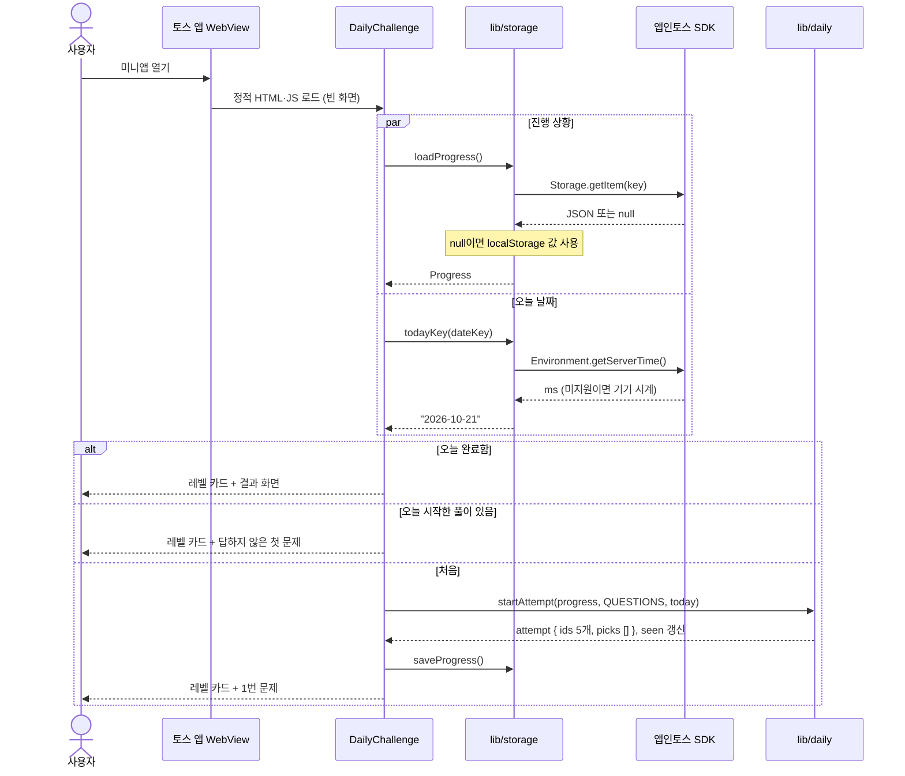
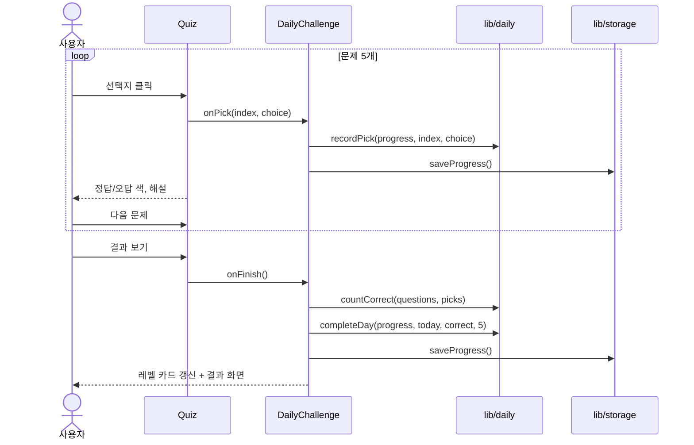
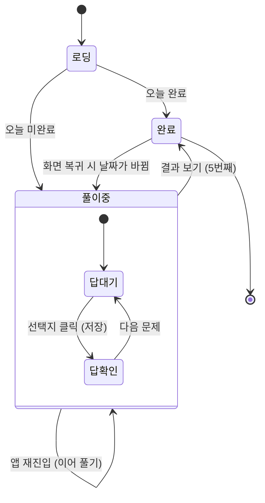
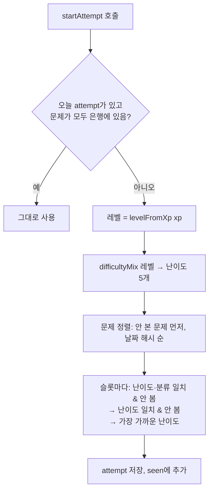
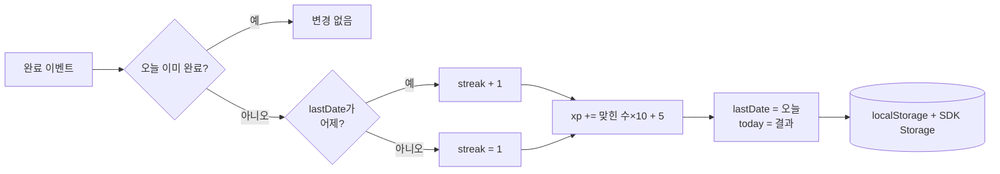
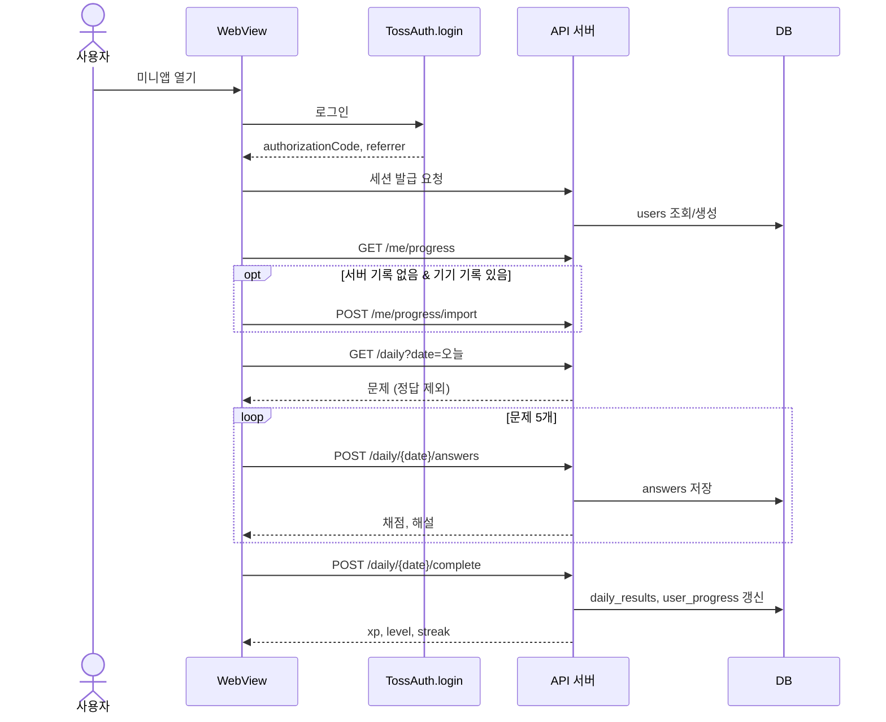

# 15. 시스템 흐름

## 1. 앱 진입 [구현]

토스 앱 밖(일반 브라우저)에서는 SDK 호출 없이 localStorage와 기기 시계만 쓴다.

## 2. 문제 풀이와 완료 [구현]

## 3. 화면 상태 전이

## 4. 문제 선택 흐름

## 5. 진행 상황 갱신 흐름

## 6. 서버 연동 후 흐름 [계획]

서버 연동 후에는 채점과 XP 계산이 서버로 옮겨져 일반 브라우저에서의 기기 시간 조작 문제([12_상세_설계](12_상세_설계.md) 8장)도 해소된다.
